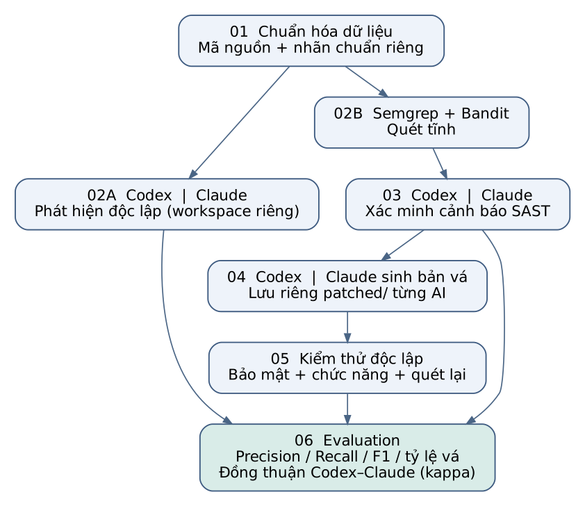

# E2 — So sánh AI và SAST trong phát hiện, vá lỗ hổng Python

Đề tài so sánh ba cách phát hiện lỗ hổng trên OWASP BenchmarkPython:

| Cách | Mô tả |
|---|---|
| **SAST** | Semgrep, Bandit |
| **AI Blind** | AI (Codex, Claude…) tự đọc mã nguồn, không thấy kết quả SAST |
| **AI Hybrid** | AI xác minh từng cảnh báo SAST: đúng, sai hay chưa chắc |

Sau đó cho AI sinh bản vá cho các lỗi đã xác nhận.

AI được chạy **thủ công** (Codex trong PyCharm, Claude qua Claude Code). Script Python chỉ chọn mẫu, chạy SAST và chấm điểm, không gọi API của AI.



## Cài đặt

```powershell
python -m venv .venv
.\.venv\Scripts\Activate.ps1
python -m pip install -r requirements.txt
python -m pytest tests -q
```

## Chạy nhanh

```powershell
git clone https://github.com/OWASP-Benchmark/BenchmarkPython.git owasp-benchmark
python owasp_pipeline.py import-owasp --repo .\owasp-benchmark --limit 200 --seed 42
python owasp_pipeline.py scan
# ... chạy từng AI trong blind_<tên>/ và hybrid_<tên>/ ...
python owasp_pipeline.py evaluate
```

Hướng dẫn đầy đủ: **[README_OWASP.md](README_OWASP.md)**.

## Workspace

Các workspace được tạo ở `../E2-OWASP-workspaces/`, ngoài thư mục project:

```text
E2-OWASP-workspaces/
├── blind_codex/     hybrid_codex/      # Codex
├── blind_claude/    hybrid_claude/     # Claude
├── blind_<tên>/     hybrid_<tên>/      # AI khác (nếu có)
└── evaluation/                         # đáp án + kết quả chấm, không cho AI đọc
```

Quy tắc:

- Mỗi phiên AI chỉ mở **một** workspace.
- AI không được đọc `evaluation/`, đáp án OWASP hay kết quả của AI khác.
- Không sửa `samples/` (có kiểm tra SHA-256). Bản vá ghi vào `patched/`.

## Cấu trúc project

```text
it5421/
├── owasp_pipeline.py        # Pipeline chính: import-owasp, add-agent, scan, normalize, verify, evaluate
├── pipeline.py              # Pipeline demo 6 mẫu (bên dưới)
├── validate_patch.py        # Kiểm thử bản vá S001 của demo
├── prompts/, rules/e2.yml   # Prompt và rules Semgrep của demo
├── demo_source/             # S001.py … S006.py
├── private/demo_truth.csv   # Đáp án demo
└── tests/
```

## Demo 6 mẫu

Dùng để thử quy trình nhanh trước khi chạy OWASP. Workspace demo nằm ở `../E2-workspaces/`; Codex dùng `blind/`, `hybrid/`, Claude dùng `blind_claude/`, `hybrid_claude/`.

```powershell
python pipeline.py prepare     # tạo workspace
python pipeline.py scan        # Semgrep (rules/e2.yml) + Bandit
# mỗi AI: blind → gửi prompt.txt → results/ai.json
#         hybrid → gửi prompt.txt → results/triage.json
python pipeline.py evaluate    # chấm và so sánh các AI
python validate_patch.py       # kiểm thử bản vá S001 (nếu có)
```

## Chỉ số

Một dự đoán chỉ được tính khi khớp **(testcase, CWE mục tiêu)** của đáp án.

| Chỉ số | Công thức |
|---|---|
| Precision | `TP / (TP + FP)` |
| Recall | `TP / (TP + FN)` |
| F1 | `2TP / (2TP + FP + FN)` |

## Tham khảo

- [OWASP BenchmarkPython](https://github.com/OWASP-Benchmark/BenchmarkPython)
- [JetBrains Codex Agent](https://www.jetbrains.com/help/ai-assistant/codex-agent.html)
- [Claude Code](https://docs.claude.com/en/docs/claude-code/overview)
